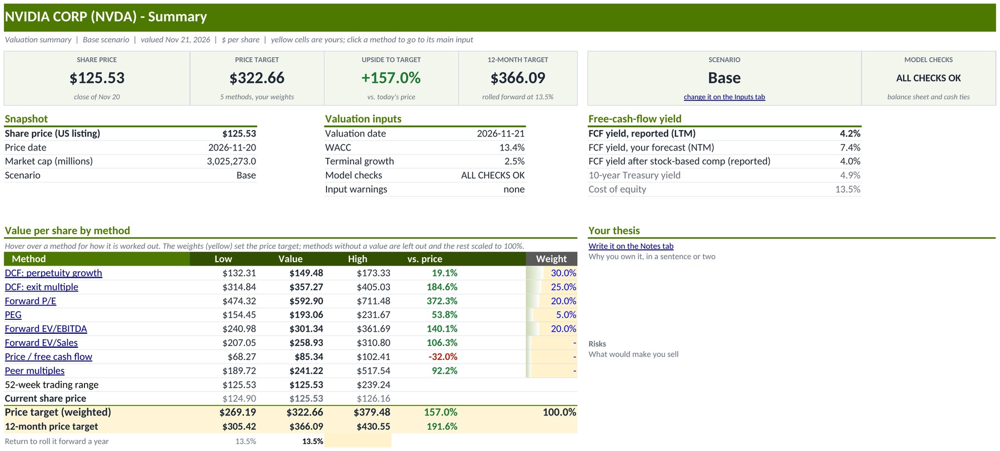
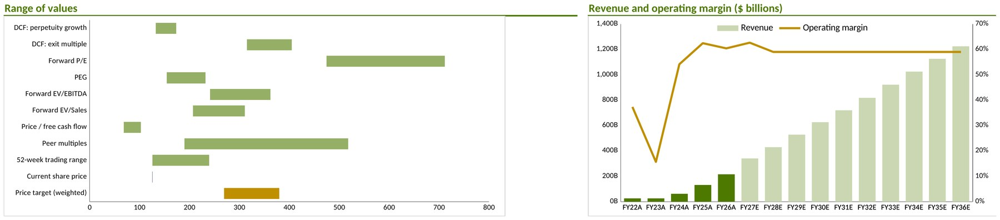

# EDGAR financial models

[](https://github.com/iMXRaid3R/SEC-to-DCF-Model/actions/workflows/tests.yml)

Builds an Excel valuation model for a public company straight from its SEC filings, in one command (or from a
menu). Each workbook has:

- three linked statements with up to 15 years of history and a 3-20 year forecast, driven by Bear / Base / Bull
  scenarios you can override line by line;
- a DCF with its own WACC tab, forward multiples (P/E, PEG, EV/EBITDA, EV/Sales, price / free cash flow), peer
  comparables, and a bridge from enterprise value to value per share;
- a dashboard Summary with a price target that blends the methods with your weights;
- ratios, integrity checks, and notes that survive rebuilds.

Rebuild after earnings and your typed inputs are kept, with a report of what changed in the filings. A roll-up
reads every workbook into one portfolio table.

The data comes from the SEC's free XBRL "company facts" API. Prices, exchange rates and betas are live Excel
formulas (`STOCKHISTORY`), so the workbooks need Microsoft 365.

This is a personal research tool. Its output is a starting point for your own assumptions, not investment advice.





NVIDIA built with default settings and its brand colour, priced at the close of 20 November 2026. It shows what
the tool produces, not a view on the stock. More tabs: [Inputs](docs/inputs.jpg), [Scenarios](docs/scenarios.jpg),
[Drivers](docs/drivers.jpg), [WACC](docs/wacc.jpg), [DCF](docs/dcf.jpg), [Multiples](docs/multiples.jpg),
[Comps](docs/comps.jpg).

**Used an earlier version?** See [Upgrading from an older version](#upgrading-from-an-older-version) and
[CHANGELOG.md](CHANGELOG.md). Nothing needs reinstalling.

## Setup

1. Install [uv](https://docs.astral.sh/uv/). It fetches Python and the packages the first time you run.
2. Run `./run --setup` in Git Bash (`.\run.bat --setup` in PowerShell, `run --setup` in cmd). It asks for the contact email the SEC
   requires with every request and saves it in `.edgar_email`, and creates `watchlist.json` from the example.
   Both files are git-ignored, so they stay on your computer.
3. Edit `watchlist.json`: your holdings and watchlist, each company's peers for the Comps tab, and optionally
   brand colours. A ticker that isn't listed still builds, just without peers.
4. Run `./run` (PowerShell: `.\run.bat`; or double-click `run.bat`) for the menu, pick "Build or update a company", and open the
   workbook it makes in Excel. `./run NVDA` does the same in one step.

On a Mac or Linux, run `chmod +x run` once, then use `./run`. Building workbooks works there; `--rollup` and
`--writeup` read values through Excel on Windows, so they are Windows-only.

## Upgrading from an older version

No reinstall: update the code, then rebuild your workbooks. Your typed inputs come along.

1. **Close your workbooks in Excel.**
2. **Update the code.**
   - If you cloned the repository: `git pull` in the project folder.
   - If you downloaded a ZIP: download the new one and unzip it to a new folder, then copy across from the old
     folder: `.edgar_email`, `watchlist.json`, `overrides/` (if you added any), your `*_financials.xlsx`
     workbooks, and `valuation_log.csv` (your roll-up history). `backups/` and `cache/` are optional.
   - Mac or Linux: run `chmod +x run` again if `./run` stops working.
3. **Rebuild:** `./run --list all` (or `./run TICKER` one at a time). Each old workbook is copied to `backups/`
   first. The build lists every input it carried over: values you typed move into the new override cells and
   tabs (DCF settings to the WACC, Bridge and DCF tabs, scenario inputs to the Scenarios tab, dilution to the
   Bridge tab). A **formula** you typed into a cell is not moved; the build names it so you can re-enter it.
4. **Optional:** new settings in `watchlist.json` - `default_parts`, `default_history_years`,
   `default_forecast_years`, `brand_colors`, `use_brand_colors`. Nothing breaks without them; copy the ones you
   want from `watchlist.example.json`.

Workbooks you don't rebuild still open and work, but the roll-up and write-up expect the new layout, so rebuild
before using those. The whole list of changes is in [CHANGELOG.md](CHANGELOG.md).

## The menu

Run `./run` (PowerShell: `.\run.bat`; or double-click `run.bat`) with nothing after it for a menu: build a company and pick
its parts, build a watchlist group, roll up the portfolio, write a one-page summary, or see what changed. Each
choice prints the command it runs, so you can type it directly next time.

## Choosing what to build

The core model is always built: Summary, Inputs, Scenarios, Drivers, the three linked statements, Ratios, Checks
and Notes. The rest is optional:

| Part | Tab | Switch it off with |
|---|---|---|
| DCF | WACC, DCF and Bridge tabs: discount rate, two terminal values, sensitivity grids, reverse DCF | `--no-dcf` |
| Multiples | Multiples: forward P/E, PEG, EV/EBITDA, EV/Sales, price / free cash flow | `--no-multiples` |
| Comps | Comps: peers' multiples (needs peers in `watchlist.json` or `--peers`) | `--no-comps` |
| Revenue Build | Revenue Build: segment-by-segment revenue | `--no-revenue-build` |

`--statements-only` builds the core model alone; `--parts dcf,multiples` names exactly what you want, and
`--parts all` turns everything back on. A workbook remembers its parts, so a plain rebuild keeps them.

History and forecast length: `--years N` (2-15 fiscal years of history, default 5) and `--forecast-years N`
(3-20, default 10). The menu asks for both. A workbook remembers them too, and `"default_history_years"` /
`"default_forecast_years"` in `watchlist.json` set them for new workbooks. If the SEC data has fewer annual
reports than you ask for, the build says so and uses what there is. Set
`"default_parts"` in `watchlist.json` (e.g. `"dcf,multiples"`) to change what new workbooks get. Inputs you
typed on a tab you switch off are kept in the workbook and return when you switch it back on.

## Everyday commands

Run these from the project folder. They are written for Git Bash (and Mac / Linux): `./run`. In PowerShell
type `.\run.bat` instead of `./run` (PowerShell doesn't run files from the current folder by their bare name),
and in cmd just `run`.

| Command | What it does |
|---|---|
| `./run` | The menu |
| `./run NVDA` | Build or rebuild `NVDA_financials.xlsx` (add `--open` to open it in Excel afterwards) |
| `./run NVDA --statements-only` | The core model only, no valuation tabs |
| `./run --list holdings` | Build every ticker in a `watchlist.json` group (`holdings`, `watchlist`, `all`) |
| `./run --rollup` | Read every built workbook through Excel and write `Portfolio.xlsx` and `valuation_log.csv` |
| `./run --rollup --base-only` | Same, Base scenario only (about a third of the time) |
| `./run --writeup NVDA` | One-page Markdown summary in `writeups/`: values, scenarios, assumptions, your notes |
| `./run NVDA --since backups/NVDA_financials_<date>.xlsx` | Show what changed between an older workbook and today's SEC data; builds nothing |
| `./run NVDA --find accrued` | List the company's XBRL tags matching a word, to fill an empty line |
| `./run NVDA --reset Beta` | Put a typed input back to its default |
| `./run --fetch all` | Download data only, build nothing |
| `./run --comps NVDA AVGO AMD` | Standalone comparables table |

Other options: `--peers T1 T2`, `--parts LIST`, `--years N`, `--forecast-years N`, `--no-dcf`, `--no-multiples`, `--no-comps`, `--no-revenue-build`, `--template financial`,
`--offline`, `--refresh`, `--fresh`. Run `./run --help` for the full list.

Close a workbook in Excel before rebuilding it.

## After earnings: what changed

Every rebuild compares the previous workbook with the new SEC data and prints what moved: the newly reported
quarter against the same quarter a year earlier, trailing-twelve-month figures and margins before and after,
the balance sheet, and any earlier years that were restated. When a new period arrived the report is also
saved in `changes/` (git-ignored). `./run --list holdings` ends with the list of companies that had a new
filing, and `./run --rollup` then shows how each value per share moved since its previous roll-up.

The SEC's data updates when the 10-Q or 10-K is filed, which can be days or weeks after the earnings release.

## What's in a workbook

| Tab | Purpose |
|---|---|
| Summary | A one-screen dashboard: headline cards (price, price target, upside, 12-month target, scenario, checks), snapshot, valuation inputs and FCF yield panels, value per share by method with your weights, the football-field and revenue-and-margin charts, your thesis from Notes, what the price implies, today's multiples, key figures |
| Inputs | The control panel: scenario, price and currency, shares outstanding; every other setting is listed with its value and a link to the tab where it is typed |
| Scenarios | Bear / Base / Bull: each driver's year-1, mid-point and final-year values, your overrides of them, and the scenario probabilities |
| Drivers | The yearly growth and margin paths the model uses (history, then the selected scenario), your per-year overrides, and the results for the selected scenario |
| Revenue Build | Optional segment build that replaces the single revenue growth driver |
| Income Statement, Balance Sheet, Cash Flow | History (5 years by default), LTM, year to date, and the forecast (10 years by default); subtotals ruled, and growth and margins in grey under the income statement's key lines |
| WACC | The discount rate: risk-free rate, equity risk premium and beta (measured from prices, with its window), cost of debt with last year's interest / debt for reference, market-value weights, and the WACC |
| Bridge | From enterprise value to value per share: debt (with leases if you choose), cash, other owners' interests, other assets and claims, and the diluted share count with options and stock units |
| DCF | Results first, then its settings (terminal growth, exit multiple, method choices) with the WACC and the bridge linked in, free cash flow, two terminal-value methods, the two sensitivity grids side by side, reverse DCF |
| Multiples | Next-twelve-months EPS, EBITDA, revenue and free cash flow; a target multiple with a low-high range for each method, and an On / Off switch. Beside each: today's price on your forecast (next twelve months), today's price on reported results (last twelve months) and the peer median, which is also trailing, so the last two compare like with like |
| Comps | Peers, their multiples, and the value they imply |
| Ratios | Growth, margins, returns (ROE, ROIC, ROA), cash flow, leverage and per-share figures, history and forecast |
| Checks | The balance checks, each with a green tick or red cross |
| Notes | Your thesis and sources (column A is kept across rebuilds) |
| Mapping, Raw | Which filing tag fed each number |

**Inputs sit next to what they change.** The discount-rate settings are on the WACC tab, the DCF's own at the top
of the DCF tab, debt, cash and dilution on the Bridge tab, multiple targets on the Multiples tab, the Bear /
Base / Bull cases on Scenarios, single-year overrides on Drivers, and the price-target weights on the Summary. The
Inputs tab lists every setting with its current value: click a blue underlined name to jump to it. The top
row of every tab with inputs shows the scenario, price target and upside, and the DCF and multiples values,
so you see the effect of a change where you make it. On the Summary, click a method's name to go to its main
input. Each number is typed in one place only, so two copies can never disagree.

**Overrides never delete a formula.** Wherever the model suggests a value, the suggestion stays in its own
cell and you type yours in a yellow override cell beside it; clear yours to go back. The model uses yours when
there is one:

| Where | Default | Your override |
|---|---|---|
| WACC, Bridge and DCF settings | Default column (e.g. beta from prices, exit multiple from peers, dilution from the filings) | Your override column |
| Multiples | Default target (peer median or a set multiple) | Your target; Range +/- sets Low / High |
| Scenarios, Bear / Base / Bull | Scenario inputs (defaults) table | Your overrides table below it, same layout |
| Drivers, single years | The scenario path in the rows at the top | Your overrides by year (that year is shaded orange at the top) |
| Revenue Build | Segment growth = Drivers revenue growth | Your growth overrides |
| Summary | Return to roll the target forward (grey) | The yellow cell next to it |
| Inputs | Shares outstanding from the filings | Shares outstanding override |

**Look.** Every tab has a title bar in the company's colour, no gridlines, and long explanations as hover
notes (cells with a red corner). The colour comes from `"brand_colors"` in `watchlist.json` (hex, e.g.
`"META": "0064E0"`); companies without one use navy, and `"use_brand_colors": false` turns it off. Colours too
light for white text, or flat black, are adjusted automatically. Only the frame takes the brand colour: the
colours that mean something stay fixed.

Colours: **yellow cells are inputs** - anything with a yellow fill is safe to change and is kept when the
workbook is rebuilt. Everything else is calculated: blue type is data from the filings, black a formula, green a
link to another tab. No yellow cell holds a formula, so typing in one can't break anything.

## Price target

The Summary tab has a **Weight** column next to each valuation method. The weighted blend is the **price
target**, shown as a gold bar on the chart, with a low-high range from the methods' own ranges. Methods with no
value (switched off, not built, or negative earnings) are left out and the other weights scaled back to 100%.

| Method | Default weight |
|---|---|
| DCF: perpetuity growth | 30% |
| DCF: exit multiple | 25% |
| Forward P/E, Forward EV/EBITDA | 20% each |
| PEG | 5% |
| Forward EV/Sales, Price / free cash flow, Peer multiples | 0% |

Price / free cash flow is left out by default: at its default multiple, 1 / (WACC - growth), it is a one-stage
DCF and would count the DCF twice. The Summary shows the free-cash-flow yield instead (FCF / market cap) on
reported results, on your forecast, and after stock-based compensation, next to the Treasury yield and the
cost of equity.

The **12-month price target** rolls the target forward a year at the cost of equity less the dividend yield
(type your own return in the yellow cell below it). The roll-up and write-up report the target for each
scenario and a probability-weighted target across Bear, Base and Bull.

## Things worth knowing

- **Your inputs survive rebuilds.** Anything you type into an input cell is carried into the next build and
  listed in the console. The previous file is copied to `backups/` first. Tabs you add yourself are not carried.
- **Scenarios.** The Scenario dropdown on Inputs switches the whole model. A workbook shows one scenario at a
  time; the roll-up reads all three and applies the probabilities set on the Scenarios tab.
- **Stock splits and fiscal years.** Share counts and per-share figures from before a split are restated in
  today's shares (the build lists the splits it found; the Raw tab marks restated figures). Fiscal years carry
  the company's own name: NVIDIA's year ending January 2026 is FY2026.
- **Year one uses reported results.** When a 10-Q is newer than the last 10-K, the first forecast year is the
  months already reported plus a forecast for the rest.
- **PEG.** The fair P/E is the target PEG (default 1.0) times the forecast's yearly EPS growth in percent, over
  a window you set on the Multiples tab (default five years). It is blank when EPS or its growth isn't positive.
  Peer medians on the Comps tab are trailing multiples, so as targets for forward figures they lean generous.
- **Valued as of today.** The elapsed part of year one is excluded and net debt comes from the latest balance sheet.
- **Defaults are conventions, not views.** Risk-free rate: the current 10-year Treasury yield. Equity risk
  premium: set in `watchlist.json` (currently Damodaran's January 2026 figures). Beta: five-year monthly against
  SPY with the Blume adjustment. Base-case drivers: three-year averages, with year-one growth capped at 30%.
- **Filling gaps.** After a build, any empty line the valuation depends on is listed with the company's closest
  tags. Add the right one to `overrides/<TICKER>.json`; see `overrides/ISRG.json` for the format.

## What it handles and what it doesn't

- **Handles:** US companies filing 10-K and 10-Q; foreign filers on 20-F or 40-F under US GAAP or IFRS, in any
  reporting currency (annual data only), with the dollar share price converted through a live rate and an ADR
  ratio set in `watchlist.json`.
- **Banks and insurers** get a different workbook automatically (or with `--template financial`): free cash
  flow and net debt don't describe them, so they are valued on equity. The forecast is a return on equity and a
  payout; value is book equity plus the present value of returns above the cost of equity, with an exit
  price-to-book cross-check. It has Summary, Inputs and Equity Model tabs and works with the roll-up and write-up.
  It keeps the simpler older arrangement (settings, dilution and probabilities on Inputs). Preferred stock is
  not separated from common equity, and a company that doesn't report shareholders' equity
  on its own line (Brookfield, for example) can't be valued this way.
- **Gaps in the SEC data:** some companies have no usable share count (multiple share classes; type it in the
  share count override on Inputs), some don't tag a line such as depreciation, and a foreign filer's latest year can be missing.
- **Roll-up and write-up:** Windows with Excel only, because they read calculated values through Excel.

## Tests

```
uv run --with pytest --with requests --with pandas --with openpyxl pytest tests/test_model.py
```

These run offline on saved filings in `tests/fixtures`, and GitHub runs them on every push
(`.github/workflows/tests.yml`; the badge at the top shows the result). `tests/test_excel.py` recalculates workbooks in real
Excel (Windows, add `--with pywin32`).

## Layout of the code

```
edgar_etl.py        command line
edgar/sec.py        downloads and cache (SEC, Treasury yield)
edgar/mapping.py    line item -> XBRL tags (US GAAP and IFRS)
edgar/transform.py  filings -> annual, LTM and year-to-date values
edgar/layout.py     every row of every sheet and its formulas
edgar/xl_*.py       sheet writers (model, inputs, DCF, summary, revenue build)
edgar/xl_style.py   the house style: colours, title bars, brand accent
edgar/xl_multiples.py  the Multiples tab
edgar/xl_wacc.py    the WACC tab
edgar/xl_bridge.py  the Bridge tab (enterprise value to value per share)
edgar/parts.py      which optional parts a build includes
edgar/menu.py       the menu shown by ./run with no arguments
edgar/xl_fin.py     the financials template (banks, insurers)
edgar/comps.py      comparables
edgar/inputs.py     keeps typed inputs across rebuilds
edgar/rollup.py     portfolio roll-up through Excel
edgar/writeup.py    one-page Markdown write-up
edgar/changes.py    what changed since the last build
```

## Licence

MIT. See `LICENSE`.
